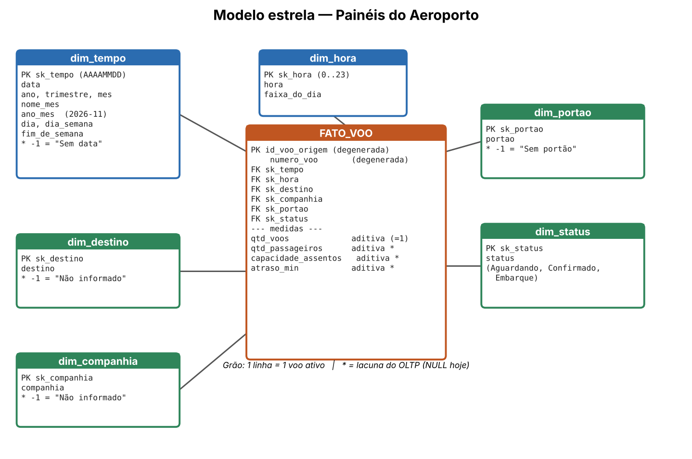
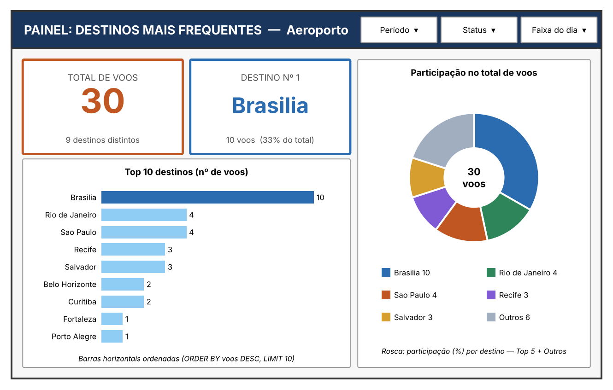

# Prática: Painéis do Aeroporto (modelo dimensional)

> O código SQL está em `database/dw_aeroporto.sql` (esquema estrela, ETL e as
> cinco consultas). Desenhos em `docs/estrela.png` e `docs/wireframe_painel1.png`.
> A lógica (ETL + consultas 1, 3 e 5) foi conferida em SQLite com os 30 voos do
> script original; o script em si usa sintaxe MySQL 8 e deve ser rodado no seu
> MySQL para confirmar. **Atenção:** o ETL lê `voos.aeroporto_destino` (estado
> atual do projeto, após as migrations 003/004); um banco sem essas migrations
> precisa trocar para `destino` (comentário no próprio SQL).

## Lacunas do modelo OLTP (entregável 5)

O OLTP do projeto tem só `voos` (`id`, `numero_voo`, `destino`, `portao`,
`horario`, `status`, `deleted_at`), além de `usuarios` e `auditoria`, que não
servem aos painéis.

| # | Lacuna | Consequência | Correção sugerida no OLTP |
|---|---|---|---|
| 1 | Não há **data** do voo: `horario` é só `TIME` | Sem dimensão tempo real: impossível ver qualquer painel **por mês** | `data_partida DATETIME` (ou `DATE` + `horario`) |
| 2 | Não há **passageiros** nem reservas | **Painel 2** (passageiros por mês) não pode ser alimentado | Tabelas `passageiros` e `reservas (voo_id, passageiro_id, status)` |
| 3 | Não há **companhia aérea** | **Painel 4** não pode ser alimentado | Tabela `companhias` + `voos.companhia_id` |
| 4 | Não há **origem** | Só se vê o destino; rotas (origem-destino) impossíveis | `voos.origem` (ou `aeroporto_origem`) |
| 5 | Não há **capacidade** nem horário real | Sem taxa de ocupação e sem atraso | `capacidade`, `horario_real` |
| 6 | `status` guarda só o **estado atual**, sem histórico | Não dá para contar "voos que já foram Embarque" ao longo do tempo | Tabela de histórico de status (a de log dos triggers da Aula de Triggers serve) |
| 7 | `aeroporto_destino` é texto livre (`Brasilia`, `Sao Paulo`) | Risco de grafias diferentes virarem destinos diferentes | Tabela `aeroportos` com sigla; no ETL, `TRIM` e normalização |

Consequência para os painéis: **1, 3 e 5 funcionam hoje**; **2 e 4 dependem das
lacunas 1 a 3**. No DW, as dimensões `dim_tempo` e `dim_companhia` já existem e
têm o membro "Não informado" (-1), então o modelo não muda quando o OLTP ganhar
esses dados: só o ETL passa a carregá-los.

## 1. Modelo estrela

**Grão:** *uma linha de `fato_voo` representa um voo (ativo) cadastrado no
OLTP.*

**Medidas**

| Medida | Tipo | Observação |
|---|---|---|
| `qtd_voos` | aditiva | sempre 1; some com `SUM`, nunca conte linhas de um join |
| `qtd_passageiros` | aditiva | passageiros do voo (lacuna 2); somada por mês, conta **viagens**, não pessoas distintas |
| `capacidade_assentos` | aditiva | lacuna 5 |
| `atraso_min` | aditiva | a média de atraso é `SUM(atraso_min) / SUM(qtd_voos)`, que não é aditiva |
| taxa de ocupação | **não aditiva** | não é guardada: calcula-se `SUM(qtd_passageiros) / SUM(capacidade_assentos)` |

Nenhuma medida é semiaditiva neste grão (seria, por exemplo, o número de
portões ocupados em um snapshot diário, que não se soma ao longo do tempo).

**Dimensões**

| Dimensão | Atributos principais | Origem no OLTP |
|---|---|---|
| `dim_tempo` | `sk_tempo` (AAAAMMDD), `data`, `ano`, `trimestre`, `mes`, `nome_mes`, `ano_mes`, `dia`, `dia_semana`, `fim_de_semana` | lacuna 1 (hoje só "Sem data") |
| `dim_hora` | `hora` (0-23), `faixa_do_dia` | `HOUR(voos.horario)` |
| `dim_destino` | `destino` | `voos.aeroporto_destino` |
| `dim_companhia` | `companhia` | lacuna 3 (hoje só "Não informado") |
| `dim_portao` | `portao` | `voos.portao` |
| `dim_status` | `status` | `voos.status` |
| degeneradas na fato | `id_voo_origem`, `numero_voo` | `voos.id`, `voos.numero_voo` |

**Estrela** (desenho: `docs/estrela.png`)



```
              dim_tempo        dim_hora
                   \             /
                    \           /
 dim_destino ------ FATO_VOO ------ dim_portao
                    /           \
                   /             \
          dim_companhia       dim_status

FATO_VOO: id_voo_origem (PK), numero_voo,
          sk_tempo, sk_hora, sk_destino, sk_companhia, sk_portao, sk_status,
          qtd_voos, qtd_passageiros, capacidade_assentos, atraso_min
```

**Uma única tabela fato atende aos cinco painéis?** Sim. Todos perguntam
"quantos voos ou passageiros, por tempo, destino, companhia, hora ou status",
e isso é respondido por medidas do **voo** com dimensões em volta dele. Os
passageiros por mês cabem porque `qtd_passageiros` é uma medida aditiva do
voo. Uma segunda fato só seria necessária para perguntas sobre a **pessoa**
(passageiros distintos, perfil, quem voou mais de uma vez), com grão
"um passageiro em um voo".

## 2. Fichas dos painéis (entregável 2)

```
PAINEL: 1. Destinos mais frequentes
Pergunta de negócio:   Para quais destinos o aeroporto mais opera voos?
Indicador (medida):    qtd_voos (SUM)
Dimensões usadas:      dim_destino  (opcional: dim_tempo, dim_status)
Filtros do painel:     período (quando houver data), status do voo
Gráfico sugerido:      barras horizontais ordenadas, Top 10
Operação OLAP:         (x) slice  ( ) dice  (roll up de voo para destino)
```

```
PAINEL: 2. Passageiros por mês
Pergunta de negócio:   Como o número de passageiros evolui ao longo dos meses?
Indicador (medida):    qtd_passageiros (SUM)
Dimensões usadas:      dim_tempo (mês); opcional dim_destino / dim_companhia
Filtros do painel:     ano, destino, companhia
Gráfico sugerido:      linha (ou colunas) por mês, mês a mês no eixo X
Operação OLAP:         (x) roll up (dia -> mês)  (x) drill down (mês -> dia)
```
*Depende das lacunas 1 e 2.*

```
PAINEL: 3. Número de voos
Pergunta de negócio:   Quantos voos o aeroporto opera e como se dividem por situação?
Indicador (medida):    qtd_voos (SUM)
Dimensões usadas:      dim_status (opcional: dim_tempo, dim_destino)
Filtros do painel:     período, destino
Gráfico sugerido:      cartão com o total + barras (ou rosca) por status
Operação OLAP:         (x) roll up (total)  (x) drill down (por status)
```

```
PAINEL: 4. Companhia aérea mais atuante
Pergunta de negócio:   Qual companhia opera mais voos e qual sua participação?
Indicador (medida):    qtd_voos (SUM) e % do total
Dimensões usadas:      dim_companhia  (opcional: dim_tempo)
Filtros do painel:     período, destino
Gráfico sugerido:      barras ordenadas + rosca com a participação
Operação OLAP:         (x) slice  (x) dice (período x destino)
```
*Depende da lacuna 3.*

```
PAINEL: 5. (livre) Pico de operação por horário
Pergunta de negócio:   Em quais faixas do dia e horas a operação concentra mais voos?
Indicador (medida):    qtd_voos (SUM)
Dimensões usadas:      dim_hora (faixa_do_dia, hora); opcional dim_status
Filtros do painel:     status do voo, destino
Gráfico sugerido:      colunas por hora, coloridas pela faixa do dia
Operação OLAP:         (x) drill down (faixa -> hora)  (x) roll up (hora -> faixa)
```

## 3. Estrutura das consultas (entregável 3)

Todas partem da fato (`fato_voo f`). O SQL completo está em `database/dw_aeroporto.sql`.

```sql
-- 1) Destinos mais frequentes
SELECT d.destino, SUM(f.qtd_voos) AS voos
FROM fato_voo f JOIN dim_destino d ON d.sk_destino = f.sk_destino
WHERE d.sk_destino <> -1
GROUP BY d.sk_destino, d.destino
ORDER BY voos DESC, d.destino LIMIT 10;

-- 2) Passageiros por mês
SELECT t.ano_mes, SUM(f.qtd_passageiros) AS passageiros
FROM fato_voo f JOIN dim_tempo t ON t.sk_tempo = f.sk_tempo
WHERE t.sk_tempo <> -1
GROUP BY t.ano, t.mes, t.ano_mes
ORDER BY t.ano, t.mes;

-- 3) Número de voos (total e por status)
SELECT SUM(f.qtd_voos) AS total_voos FROM fato_voo f;

SELECT s.status, SUM(f.qtd_voos) AS voos
FROM fato_voo f JOIN dim_status s ON s.sk_status = f.sk_status
GROUP BY s.sk_status, s.status
ORDER BY voos DESC;

-- 4) Companhia mais atuante
SELECT c.companhia, SUM(f.qtd_voos) AS voos,
       ROUND(100 * SUM(f.qtd_voos) / SUM(SUM(f.qtd_voos)) OVER (), 1) AS pct_voos
FROM fato_voo f JOIN dim_companhia c ON c.sk_companhia = f.sk_companhia
WHERE c.sk_companhia <> -1
GROUP BY c.sk_companhia, c.companhia
ORDER BY voos DESC LIMIT 5;

-- 5) Pico de operação por faixa do dia e hora
SELECT h.faixa_do_dia, h.hora, SUM(f.qtd_voos) AS voos
FROM fato_voo f JOIN dim_hora h ON h.sk_hora = f.sk_hora
GROUP BY h.faixa_do_dia, h.hora
ORDER BY h.hora;
```

| Painel | `GROUP BY` | `WHERE` | Operação OLAP |
|---|---|---|---|
| 1 | `sk_destino, destino` | `sk_destino <> -1` (+ período/status se filtrados) | slice |
| 2 | `ano, mes, ano_mes` | `sk_tempo <> -1` (+ ano) | roll up / drill down |
| 3 | total: nenhum; quebra: `sk_status, status` | nenhum (+ período/destino se filtrados) | roll up / drill down |
| 4 | `sk_companhia, companhia` | `sk_companhia <> -1` (+ período/destino) | slice / dice |
| 5 | `faixa_do_dia, hora` | nenhum (+ status/destino se filtrados) | drill down / roll up |

Os rankings (1 e 4) usam `ORDER BY ... DESC` e `LIMIT`; as evoluções (2 e 5)
ordenam pelo tempo, porque o eixo X é cronológico.

**Para não contar em duplicidade**
- Voos: `qtd_voos` vale 1 por linha e a fato tem **uma linha por voo**
  (`id_voo_origem` é a chave primária); as consultas só fazem `JOIN` com
  dimensões (muitos para um), que não multiplicam linhas, e usam `SUM`.
- Voos apagados pelo soft delete ficam fora (`deleted_at IS NULL` no ETL).
- Passageiros: ao carregar as reservas, agregue por voo **antes** de ligar ao
  voo (`GROUP BY voo_id`). Ligar `reservas` direto ao voo repetiria a linha do
  voo uma vez por reserva e inflaria `qtd_voos`. Lembre também que somar por
  mês conta viagens de passageiro, não pessoas distintas.

## 4. ETL e wireframe (entregável 4)

**ETL (3 linhas)**
- **Extract:** de `aeroporto.voos` (`id`, `numero_voo`, `aeroporto_destino`, `portao`, `horario`, `status`), só com `deleted_at IS NULL`; futuramente também de companhias, reservas e passageiros.
- **Transform:** `TRIM` e normalização do destino; portão nulo vira "Sem portão"; `horario` vira hora e faixa do dia; data ou companhia ausentes viram "Sem data" e "Não informado" (-1); chaves substitutas (`sk_`); passageiros agregados por voo antes do join.
- **Load:** primeiro as dimensões (`dim_tempo`, `dim_hora`, `dim_destino`, `dim_companhia`, `dim_portao`, `dim_status`) e depois `fato_voo`, em recarga completa que pode ser repetida.

**Wireframe: Painel 1 (com os 30 voos do banco original)** — versão desenhada: `docs/wireframe_painel1.png`



```
+--------------------------------------------------------------------+
|  PAINEL: DESTINOS MAIS FREQUENTES                    [ Período v ] |
|                                                      [ Status  v ] |
|  +----------------------+   +-----------------------------------+  |
|  |  TOTAL DE VOOS       |   |  Participação do Top 3            |  |
|  |         30           |   |        ( rosca )                  |  |
|  |  destinos: 9         |   |  Brasilia 33% | RJ 13% | SP 13%   |  |
|  +----------------------+   +-----------------------------------+  |
|                                                                    |
|  Top 10 destinos (voos)                                            |
|  Brasilia        ██████████████████████████████  10                |
|  Rio de Janeiro  ████████████                     4                |
|  Sao Paulo       ████████████                     4                |
|  Recife          █████████                        3                |
|  Salvador        █████████                        3                |
|  Belo Horizonte  ██████                           2                |
|  Curitiba        ██████                           2                |
|  Fortaleza       ███                              1                |
|  Porto Alegre    ███                              1                |
|                                                                    |
|  Indicador principal: Brasilia lidera com 10 de 30 voos (33%)      |
+--------------------------------------------------------------------+
```

## Checklist

- [x] O grão da fato está escrito em uma frase.
- [x] A dimensão tempo permite ver o painel **por mês** (`ano_mes`, `mes`); hoje vazia por causa da lacuna 1.
- [x] Toda consulta parte da **fato** e usa só as dimensões necessárias.
- [x] Todo atributo do `SELECT` sem agregação está no `GROUP BY`.
- [x] Rankings usam `ORDER BY ... DESC` e `LIMIT`.
- [x] Contagem de voos e de passageiros pensada para não duplicar (seção 3).
- [x] O ETL carrega **dimensões antes da fato**.

## Como testar
1. Como administrador: `mysql -u root -p < database/dw_aeroporto.sql` (cria o banco `dw_aeroporto`, carrega e roda as consultas).
2. Resultados esperados com os 30 voos originais: Painel 1 com Brasilia (10), Rio de Janeiro (4), Sao Paulo (4), Recife (3), Salvador (3) (o empate sai em ordem alfabética); Painel 3 com total 30 (Confirmado 12, Embarque 10, Aguardando 8); Painel 5 com pico às 23h (4 voos; Manhã 4, Tarde 12, Noite 14); Painéis 2 e 4 sem linhas, o que evidencia as lacunas.
